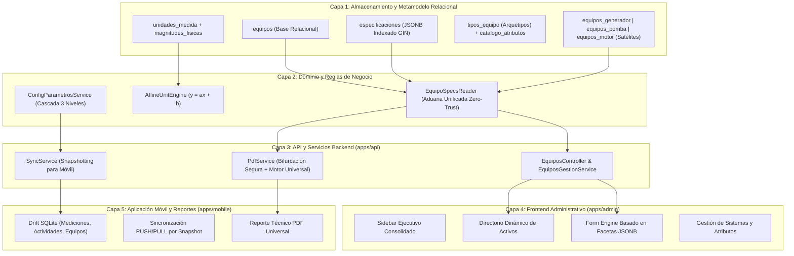
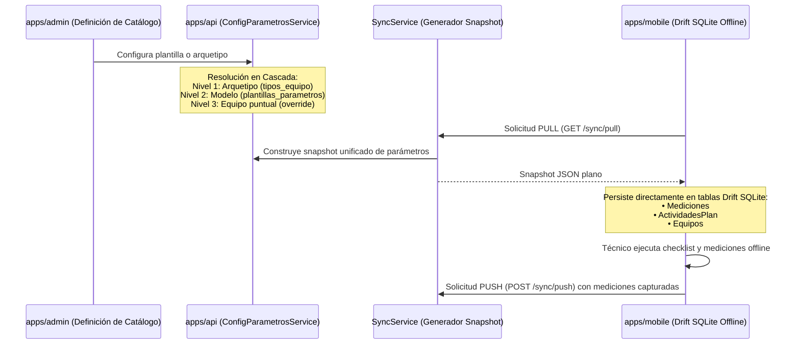

# MEKANOS ERP / EAM - METAMODELO UNIVERSAL DE ACTIVOS
## Documento Maestro 01: Especificación Técnica de Arquitectura y Metamodelo

> **Estado:** Aprobado para Implementación  
> **Nivel:** Staff / Principal Engineer (Zero-Trust & First-Principles)  
> **Fecha de Emisión:** Octubre 2026  
> **Ámbito:** `packages/database`, `apps/api`, `apps/admin`, `apps/mobile`

---

## 1. Visión y Fundamentos del Sistema

El sistema MEKANOS nació originalmente para atender dos familias de maquinaria crítica: **Plantas Eléctricas (Generadores)** y **Motobombas / Bombas Hidráulicas**. Para satisfacer rápidamente los requerimientos de placa técnica de estos dos arquetipos, se adoptó un modelo relacional de satélites rígidos (`equipos_generador`, `equipos_bomba`, `equipos_motor`).

Si bien este diseño ofreció soporte inmediato, impuso un **cuello de botella de extensibilidad estructural**: incorporar nuevas industrias (climatización HVAC, elevadores, compresores de tornillo, subestaciones o equipos informáticos) requería alterar el DDL de la base de datos, crear migraciones destructivas y bifurcar múltiples pantallas y controladores.

El **Metamodelo Universal EAM** trasciende este límite transformando a MEKANOS en una plataforma industrial configurable multi-arquetipo, manteniendo **cero regresiones** y **compatibilidad binaria retroactiva al 100%** con el parque existente de órdenes, clientes y sincronización móvil offline.

---

## 2. Las 5 Capas de la Arquitectura EAM



---

## 3. Capa 1: Metamodelo Relacional y Motor Matemático UoM

### 3.1 El Principio de Almacenamiento Híbrido Aditivo
Para garantizar el principio Zero-Trust sin provocar tiempo de inactividad ni romper dependencias foráneas existentes, la tabla `equipos` se complementa de forma aditiva:

1. **Campos Nucleares Fijos:** Se mantienen inmutables (`id_equipo`, `codigo_equipo`, `nombre_equipo`, `numero_serie_equipo`, `id_cliente`, `id_sede_cliente`, `id_tipo_equipo`, `horas_actuales`, `estado_equipo`).
2. **Contenedor Polimórfico `especificaciones` (JSONB):** Almacena las fichas técnicas dinámicas divididas en módulos funcionales tipados. Indexado mediante PostgreSQL GIN (`jsonb_path_ops`).
3. **Satélites Legados en Modo Lectura Protegida:** Las tablas `equipos_generador`, `equipos_bomba` y `equipos_motor` se conservan vivas para no invalidar el historial ni requerir re-escrituras masivas inmediatas.

### 3.2 Motor Matemático de Magnitudes Físicas ($y = ax + b$)
Para resolver definitivamente las discrepancias en unidades de medida (p. ej., `°C` vs `C`, o `L` vs `Gal`), se instaura el modelo afín de conversión:

$$\text{Valor en Unidad Canónica} = a \cdot x + b$$

* **Magnitudes Físicas Soportadas:**
  * Temperatura: Kelvin (K, base canónica). Conversión afín:
    * Celsius: $T_K = 1.0 \cdot T_{°C} + 273.15$
    * Fahrenheit: $T_K = \frac{5}{9} \cdot (T_{°F} - 32) + 273.15$
  * Presión: Pascal (Pa, base canónica). Conversión lineal ($b = 0$):
    * 1 PSI = 6,894.76 Pa
    * 1 Bar = 100,000 Pa
  * Caudal: Metros cúbicos por hora ($\text{m}^3/\text{h}$, base canónica):
    * 1 GPM = 0.227125 $\text{m}^3/\text{h}$
  * Volumen de Fluidos: Litros (L, base canónica):
    * 1 Galón USA = 3.78541 L ($1\text{ L} \approx 0.264172\text{ Gal}$)
  * Potencia Eléctrica / Mecánica: Watt (W, base canónica):
    * 1 kW = 1,000 W
    * 1 HP = 745.7 W
    * 1 kVA = $1,000\text{ VA}$ (con factor de potencia $\cos\phi = 0.8$ estándar)

---

## 4. Capa 2: Contrato JSONB Modular de Especificaciones Técnicas

El campo `equipos.especificaciones` se estructura en bloques funcionales atómicos. Cada módulo representa un subsistema físico del activo:

```json
{
  "motor": {
    "marca": "CUMMINS",
    "modelo": "6CTA8.3-G2",
    "numero_serie": "46981203",
    "potencia_hp": 310,
    "velocidad_rpm": 1800,
    "numero_cilindros": 6,
    "aspiracion": "TURBOCARGADO_POSTENFRIADO",
    "capacidad_aceite_litros": 24,
    "tipo_aceite": "15W40",
    "capacidad_refrigerante_litros": 28,
    "tipo_refrigerante": "50/50 PREMIX"
  },
  "alternador": {
    "marca": "STAMFORD",
    "modelo": "UCI274",
    "numero_serie": "C19J304910",
    "potencia_kva": 250,
    "potencia_kw": 200,
    "voltaje": "220/127",
    "frecuencia_hz": 60,
    "numero_fases": 3,
    "factor_potencia": 0.8,
    "tipo_alternador": "SIN_ESCOBILLAS"
  },
  "control": {
    "marca_modulo": "DEEP SEA",
    "modelo_modulo": "DSE7320",
    "tipo_control": "AUTOMATICO_AMF",
    "voltaje_bateria_vdc": 24
  }
}
```

### Roles Semánticos Reservados
Para que el motor de renderizado universal, el generador de PDF y las tarjetas del dashboard puedan operar de forma autónoma sin importar el arquetipo, se reservan 5 roles semánticos universales:

| Rol Semántico | Descripción Operativa | Ejemplo |
| :--- | :--- | :--- |
| `marca_principal` | Fabricante primordial del equipo completo o cabezal | `CUMMINS`, `YORK`, `OTIS` |
| `modelo_principal` | Modelo comercial o código de ingeniería del activo | `C150D5`, `YK-CHILLER` |
| `serie_principal` | Número de serie para trazabilidad legal y de garantía | `SN-2026-X88` |
| `potencia_principal` | Magnitud primaria de capacidad operativa | `250 kVA`, `100 TR`, `50 m³/h` |
| `unidad_uso` | Horómetro, odómetro, ciclos de arranque o conteo de viajes | `Horas (hrs)`, `Kilómetros (km)` |

---

## 5. Capa 3: Aduana Unificada `EquipoSpecsReader`

La clase `EquipoSpecsReader` (`apps/api/src/equipos/services/equipo-specs.reader.ts`) actúa como la única puerta de enlace de lectura para datos técnicos de equipos.

### Principios de la Aduana:
1. **Prioridad Adaptativa:** Si el activo posee especificaciones estructuradas en `especificaciones` (JSONB), las resuelve en primer orden utilizando roles semánticos.
2. **Compatibilidad Legada:** Si el activo no cuenta con JSONB dinámico, consulta las tablas satélite (`equipos_generador`, `equipos_bomba`, `equipos_motor`) respetando la jerarquía histórica exacta validada en producción.
3. **Resguardo de Nulos:** Nunca retorna excepciones `null pointer` ante campos inexistentes; entrega defaults seguros (`'N/A'`, listas vacías, valores `undefined` normalizados).
4. **Cálculo Derivado en Caliente:** Por ejemplo, calcula la capacidad de fluidos en galones comerciales aproximados a partir de los litros declarados:

$$\text{Galones Aprox.} = \text{round}(\text{Litros} \times 0.264172, 1)$$

---

## 6. Capa 4: Cascada de 3 Niveles hacia la App Móvil (Sincronización Offline)

La aplicación móvil para técnicos de campo (`apps/mobile`) requiere trabajar en sótanos, minas y cuartos de máquinas sin conexión a Internet. Para garantizar su funcionamiento ininterrumpido sin acoplarla a esquemas relacionales complejos:



### Garantía de Desacoplamiento Móvil:
* La base de datos SQLite de la App Móvil (`lib/core/database/app_database.dart`) **no realiza joins contra tablas satélite**.
* Las tablas `Mediciones` y `ActividadesPlan` almacenan copias snapshot inmutables de los nombres de parámetros, valores de rango (`valorMinimoNormal`, `valorMaximoNormal`) y unidades de medida snapshot (`°C`, `PSI`, `V`, `Hz`).
* Cualquier cambio o extensión en el backend no genera migraciones de base de datos en los dispositivos móviles ya instalados.

---

## 7. Capa 5: Arquitectura del Reporte PDF Universal

El controlador `PdfController` (`apps/api/src/pdf/pdf.controller.ts`) y su motor de generación Puppeteer/HTML aplican la regla de bifurcación de red de seguridad:

1. **Órdenes de Arquetipos Clásicos:** Si la orden corresponde a un arquetipo tradicional sin flag dinámico (`GENERADOR`, `BOMBA`), se procesa mediante las plantillas consolidadas (`GENERADOR_A`, `GENERADOR_B`, `BOMBA_A`, `CORRECTIVO`), certificadas sin desviación por el *Golden Master*.
2. **Nuevos Arquetipos o Flag Universal:** Si el equipo pertenece a un nuevo arquetipo (`HVAC`, `ELEVADOR`, `COMPRESOR`, `COMPUTADOR`) o tiene configurado `usa_plantilla_universal = true`, se despacha la plantilla `tipo-universal-eam.template.ts`.

### Componentes de la Plantilla Universal:
* **Cabecera Corporativa Mekanos:** Identidad visual, consecutivo oficial, datos de cliente y sede, fecha de visita y técnico responsable.
* **Placa Técnica Dinámica (Placa Universal):** Renderizada mediante `EquipoSpecsReader.getPlacaUniversal(equipo)`, organizada en bloques de atributos de dos columnas con sus insignias de magnitud.
* **Matriz Adaptativa de Mediciones:** Cuadrícula dinámica con formato condicional de semáforo (`NORMAL` en verde, `ALERTA` en amarillo, `CRÍTICO` en rojo).
* **Checklist Agrupado por Sistemas:** Listado de tareas agrupadas dinámicamente bajo sus encabezados del `catalogo_sistemas`.
* **Trazabilidad WMS de Repuestos:** Tablas corporativas de insumos y consumibles utilizados (Tablas A/B/C).
* **Evidencias Fotográficas y Firmas:** Fotografías antes/después con timestamp y firmas manuscritas en canvas con cédula y nombre del receptor.

---

## 8. Certificación de Invarianza (Golden Master)

Para salvaguardar la exactitud matemática y la invariabilidad de los reportes en producción, se implementó el conjunto de pruebas de regresión Golden Master (`apps/api/test/golden-master-pdf.spec.ts`):

* **Muestra de Control:** 35 órdenes de servicio reales de producción (`apps/api/test/fixtures/golden-master-pdf.json`).
* **Parámetros Verificados:** `marca`, `modelo`, `numero_serie`, capacidades y coherencia de satélites.
* **Tolerancia Permitida:** 0 discrepancias (100% de coincidencia exacta).
